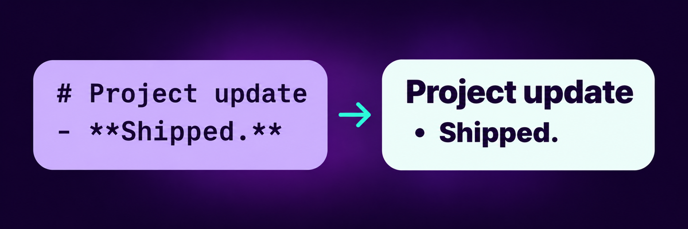

<p align="center">
  
</p>

<h1 align="center">copied.md</h1>

<p align="center">Copy Markdown as rich text, plain text, HTML source, or a format for the app you’re pasting into.</p>



copied.md runs locally. Use the macOS menu bar from any app, select text in a browser or VS Code, or pipe Markdown through the CLI. Each uses the same converter.

Download the browser, VS Code, and CLI packages from [GitHub Releases](https://github.com/0xdoublesharp/copied.md/releases).

## Build from source

Use Node 24.15 or later in the Node 24 LTS line, or Node 26 and later. Use the pnpm version pinned in [package.json](package.json).

```sh
git clone https://github.com/0xdoublesharp/copied.md.git
cd copied.md
pnpm install --frozen-lockfile
```

### macOS menu bar

On macOS 13.5 or later with Xcode Command Line Tools installed, run `pnpm build:macos-app` and open `build/portable/copied.md.app`. The package runs on Apple silicon and Intel and includes its runtime. See the [macOS build notes](docs/portable-macos-app.md) for output paths, checks, and signing.

1. Copy Markdown, for example with **Copy Message** on a T3 Code reply.
2. Press **Control–Command–C** (`⌃⌘C`).
3. The shortcut copies in your last-used format and opens the grid. Click another card to replace the copy, or switch to your destination to dismiss the grid and paste.

Use **Shortcut Behavior** in the clipboard menu to show the picker first or copy the last-used format without a picker. **Copy Markdown As…** opens the grid before copying. Click a card to copy it, or press Return to use the highlighted format. The gear menu lets you choose three, four, or five columns and hide formats you rarely use.

See the [macOS format grid in the app guide](https://www.justinsilver.com/libraries/copied-md/#macos-format-grid).

### Browser extensions

| Browser | Package command    | Install the local build                                                 |
| ------- | ------------------ | ----------------------------------------------------------------------- |
| Chrome  | `pnpm zip`         | Extract the ZIP and use **Load unpacked** in developer mode.            |
| Edge    | `pnpm zip:edge`    | Extract the ZIP and use **Load unpacked** in developer mode.            |
| Firefox | `pnpm zip:firefox` | Extract the ZIP and load its manifest temporarily in `about:debugging`. |

Browser archives are written under `apps/browser-extension/build/`. Select Markdown and choose **Copy Markdown As…** from the context menu, or paste Markdown into the extension popup to preview it. The browser’s extension settings can assign a shortcut for copying a selection with the last format.

### VS Code

Run `pnpm package:vscode` and install the generated `.vsix` with **Extensions: Install from VSIX…**. Run **Copy Markdown As…** from the command palette on selected text or an open Markdown file.

For rich clipboard output in a local macOS VS Code window, build the pasteboard helper with `pnpm build:macos` and set `copied-md.pasteboardHelper` to the executable’s absolute path.

## Copy formats

- **Rich Text** offers HTML and readable plain text. **HTML Source** copies the markup itself.
- **Slack** formats clipboard content for the composer. **Slack API (mrkdwn)** produces text for API payloads.
- **Telegram** keeps labeled links and list spacing in rich paste. Telegram for macOS reads RTF and can drop bold, italic, and code styling. Telegram Desktop clients that accept HTML can retain those styles. Plain-text paste includes full link addresses.
- **Signal** pastes bold, italics, strikethrough, monospace, and spoilers into Signal Desktop. Use `<span data-spoiler="true">spoiler text</span>` in Markdown. Links include their full addresses. Rich paste works with the macOS app, the macOS pasteboard helper, Chrome, and Edge. Firefox and other plain-text fallbacks omit spoiler contents. [Signal’s formatting guide](https://support.signal.org/hc/en-us/articles/6325622209178-Text-Formatting)
- Choose **Discord**, **Reddit**, **Facebook**, **X**, **SMS**, or **Plain Text** for other destinations.

## CLI and MCP

Run `pnpm package:cli` and install the generated tarball with `npm install -g ./0xdoublesharp-copied-md-cli-1.2.0.tgz`.

```sh
copied-md targets
copied-md convert --to html-source --file notes.md
copied-md convert --to rich-text --json < notes.md
copied-md convert --to slack-api < update.md
copied-md convert --to signal --json < update.md
```

The CLI reads a file or stdin. Use `--json` for clipboard representations, character counts, and diagnostics. Use `--source-url` to resolve relative links and `--unicode` to opt into decorative styling on supported targets.

On macOS, run `pnpm build:macos` and put `build/macos/copied-md-pasteboard` on `PATH`, or set `COPIED_MD_PASTEBOARD` to its absolute path. Then run `copied-md copy --clipboard --pick` to choose a format for the current clipboard.

For an MCP client, configure the installed CLI as a stdio server. It exposes `list_copy_targets` and `convert_markdown` for Markdown supplied in the tool call.

```json
{
  "mcpServers": {
    "copied-md": {
      "command": "/absolute/path/to/copied-md",
      "args": ["mcp"]
    }
  }
}
```

## Development

`pnpm check` runs type checks, lint, formatting, and tests. `pnpm build:all` builds the browser extensions, VS Code extension, and CLI. The shared renderer lives in [packages/converters](packages/converters).

- `pnpm test:coverage` runs the TypeScript and Vue suites and requires 100% line, statement, function, and branch coverage per source file.
- `pnpm test:fuzz` runs seeded Markdown property tests against every copy target. Set `COPIED_MD_FUZZ_RUNS=1000` for a longer run. To replay a failure, set `COPIED_MD_FUZZ_SEED` and `COPIED_MD_FUZZ_PATH` to the values in the failure report and select the failing test with `-t`.
- `pnpm test:macos` requires 100% line coverage in every production Swift file. It exercises AppKit launch and dialogs, isolated pasteboards, stale writes, subprocess conversion, Telegram and Signal clipboard formats, and temporary hotkey registration.
- `TLA2TOOLS_JAR=/path/to/tla2tools.jar pnpm test:formal` checks the macOS clipboard protocol with TLC. The [model notes](formal/clipboard/README.md) explain what it checks and how to reproduce the counterexamples.
