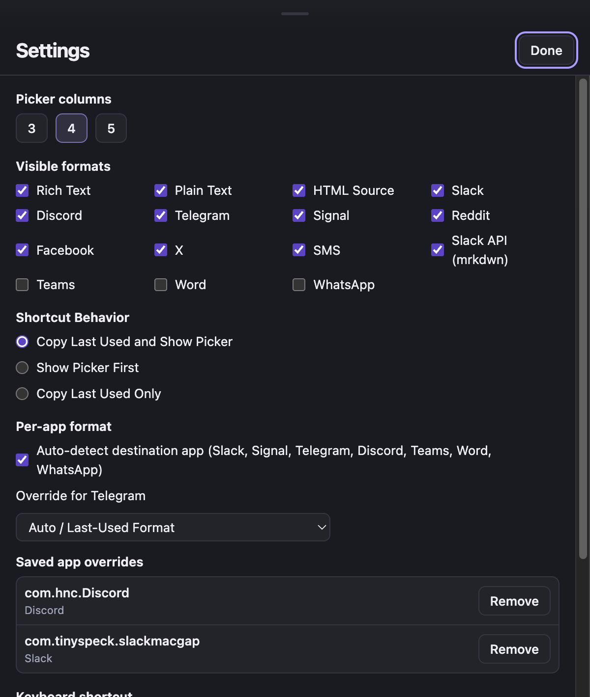

<p align="center">
  
</p>

<h1 align="center">copied.md</h1>

<p align="center">Copy Markdown as rich text, plain text, HTML source, or a format for the app you’re pasting into. Convert rich text on your clipboard back to Markdown.</p>

<p align="center">
  
</p>

copied.md converts text on your device. Use the desktop app on macOS, Windows, or Linux, convert in a terminal with the CLI, or copy directly from your browser or VS Code.

## Desktop

Check [GitHub Releases](https://github.com/0xdoublesharp/copied.md/releases) for downloads, or [build the desktop app from source](apps/desktop/README.md#build-from-source).

1. Copy Markdown from an editor, a chat reply, or another app.
2. Switch to the app where you want to paste. Press **Control–Command–C** (`⌃⌘C`) on macOS or **Ctrl+Shift+Alt+C** on Windows or X11. You can also choose **Copy Markdown As…** from the tray menu. Clipboard and shortcut availability on Wayland depends on your desktop session. [Linux session capabilities](docs/app-store-and-packaging.md#session-capabilities)
3. Hover over a format to preview it, type to filter, or press `1`–`9` to choose a numbered format. Then paste as usual.

By default, the shortcut copies immediately and opens the picker so you can choose a different format. When copied.md can identify the focused app, it can use that app’s format automatically. Set a per-app override in Settings. If you switch apps and use the shortcut again before copying anything else, copied.md reuses your original Markdown.

To go the other way, copy formatted content and choose **Copy Rich Text as Markdown** from the tray menu. The command reads HTML from the clipboard and writes GitHub Flavored Markdown.

<p align="center">
  
  
</p>

## Copy formats

| Format                            | When to use it                                                                                                                                            |
| --------------------------------- | --------------------------------------------------------------------------------------------------------------------------------------------------------- |
| **Rich Text**                     | Paste formatted headings, lists, links, tables, and task checkboxes into a rich-text editor or composer.                                                  |
| **Plain Text**, **HTML Source**   | Copy readable text or the HTML markup itself.                                                                                                             |
| **Slack**, **Slack API (mrkdwn)** | Use Slack for pasting into the composer and Slack API for an API payload. Both formats align tables in monospace.                                         |
| **Telegram**, **Signal**          | Use Telegram for its Markdown and HTML clipboard formats, or Signal for Signal Desktop’s rich clipboard format, including spoilers.                       |
| **Discord**, **Reddit**           | Use each composer’s Markdown conventions for headings, code, or spoilers.                                                                                 |
| **Teams**, **Word**, **WhatsApp** | Enable these in format settings. Teams and Word preserve table alignment and use neutral styling for code and quotes. WhatsApp uses its messaging syntax. |
| **X**, **Facebook**, **SMS**      | Copy for social posts or text messages. X includes a weighted character count for the standard 280-character limit.                                       |

See the [paste checklist](docs/paste-fidelity.md) for details to check in each destination.

## CLI and MCP

Clone the repository to build from source. For the native CLI, install the Rust toolchain pinned in [rust-toolchain.toml](rust-toolchain.toml) and ensure Cargo’s bin directory is on your `PATH`. Run the commands below from the repository root.

```sh
cargo install --path crates/copied-cli --locked
copied-md targets
copied-md convert --to rich-text --json < notes.md
copied-md convert --to telegram < update.md
copied-md convert --to slack-api --file notes.md
copied-md copy --to slack --clipboard
copied-md copy --clipboard --pick
```

`convert` writes to stdout. Use `--json` for all available clipboard representations, character counts, and diagnostics. `copy` writes to the system clipboard.

To expose `list_copy_targets` and `convert_markdown` to an MCP client, configure `copied-md mcp` as a local stdio server. Use the installed CLI executable as the command.

```json
{
  "mcpServers": {
    "copied-md": {
      "command": "/absolute/path/to/copied-md",
      "args": ["mcp"]
    }
  }
}
```

[Native and Node CLI reference](apps/cli/README.md)

## Browser and VS Code extensions

In the browser, select Markdown and right-click **Copy Markdown As…**, or paste Markdown into the extension popup. Enable ChatGPT or Claude in extension settings to add a **Copy as…** button to assistant replies. [Browser extension privacy](docs/browser-extension-privacy.md)

In VS Code, select Markdown and run **Copy Markdown As…**. With no selection in a Markdown file, the command offers to copy the whole file. [VS Code settings and macOS rich paste](apps/vscode/README.md)

To build either extension, use the Node and pnpm versions specified in [package.json](package.json). Run `pnpm install --frozen-lockfile` from the repository root, then use the command below for your editor or browser.

| Target  | Package command       | Install local build                                                               |
| ------- | --------------------- | --------------------------------------------------------------------------------- |
| Chrome  | `pnpm zip`            | Extract the ZIP and use **Load unpacked** in developer mode.                      |
| Edge    | `pnpm zip:edge`       | Extract the ZIP and use **Load unpacked** in developer mode.                      |
| Firefox | `pnpm zip:firefox`    | Extract the extension ZIP and load its manifest temporarily in `about:debugging`. |
| VS Code | `pnpm package:vscode` | Install the generated `.vsix` with **Extensions: Install from VSIX…**.            |

## Project documentation

- [Tauri and Rust architecture](docs/tauri-rust-architecture.md) and local checks
- [Packaging and store submission](docs/app-store-and-packaging.md) for desktop releases
- [Chrome Web Store submission](docs/chrome-web-store.md) and permission explanations
- [Clipboard and desktop engine models](formal/clipboard/README.md)
- [Feature comparison for copied.md 2.0](docs/feature-matrix.md)
