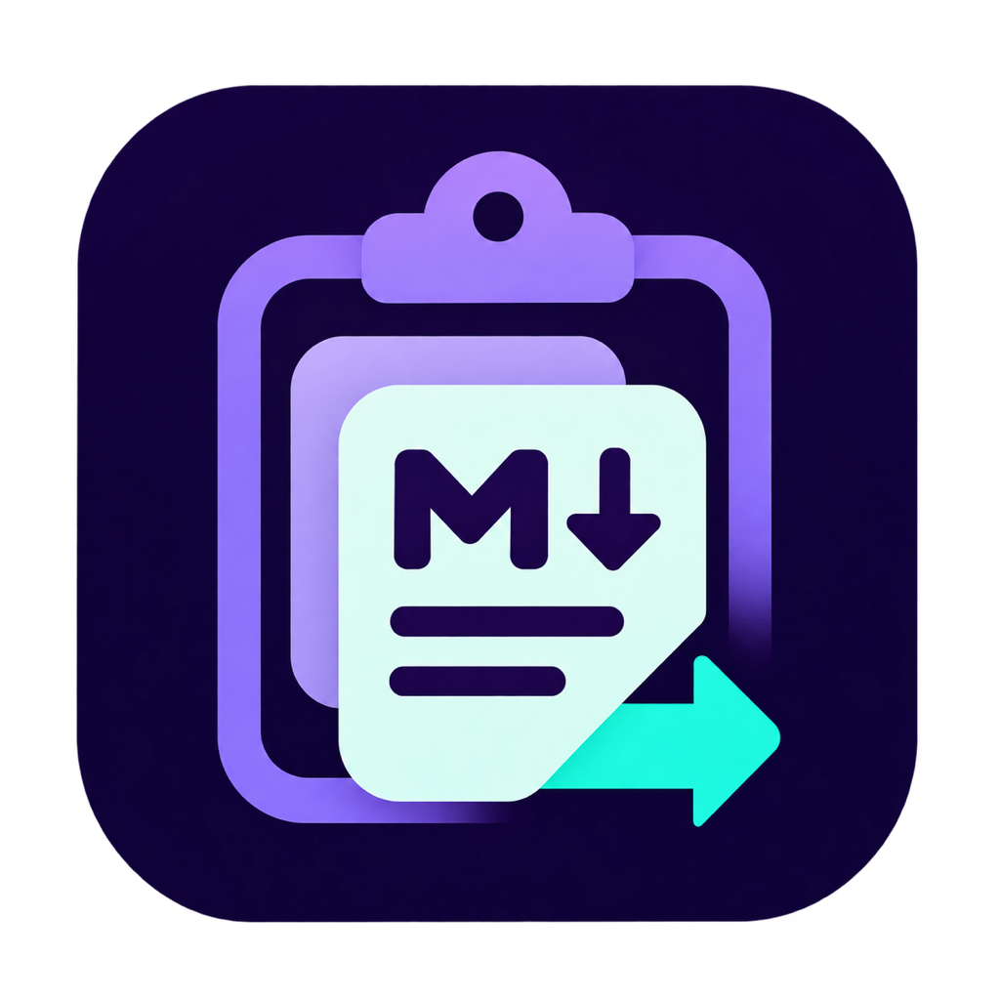
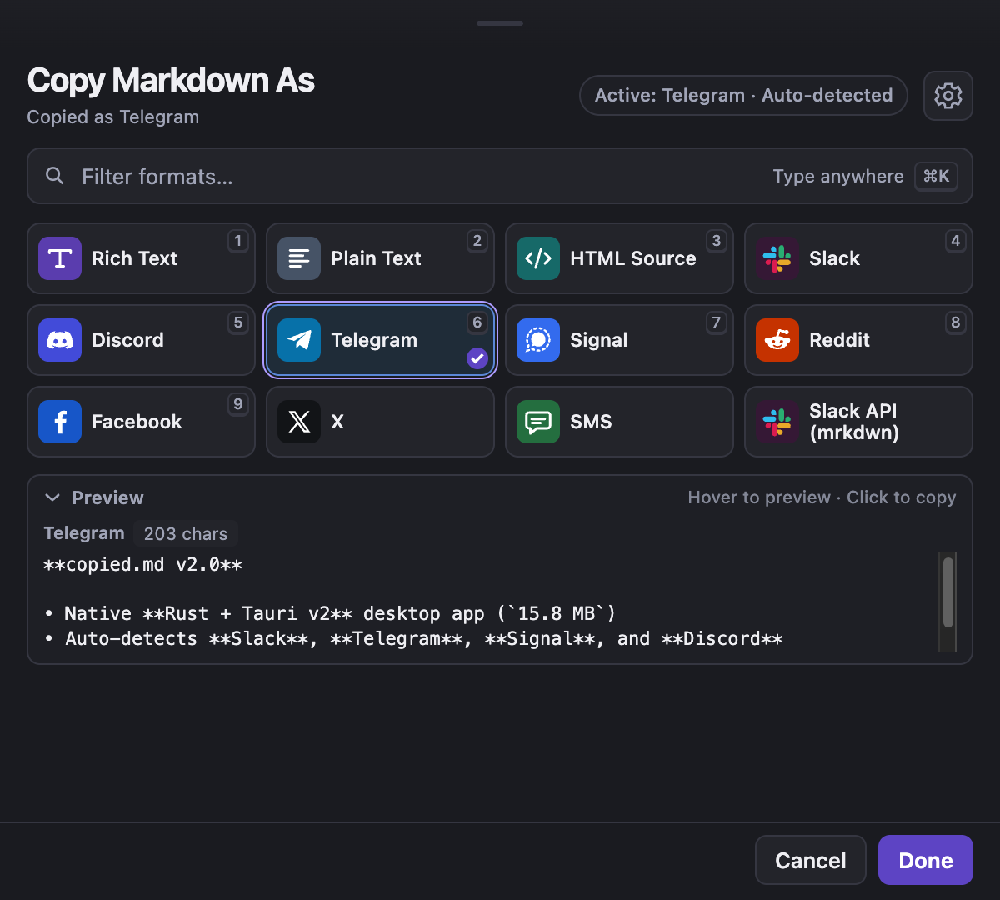
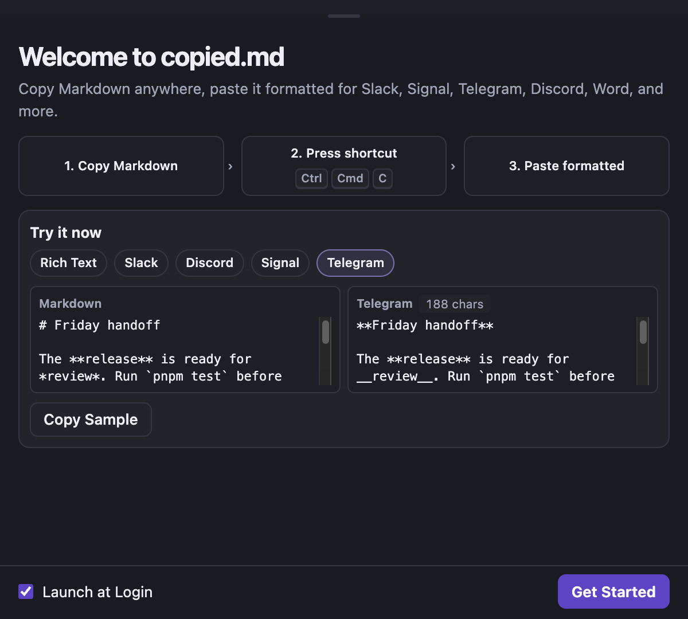

<p align="center">
  
</p>

<h1 align="center">copied.md</h1>

<p align="center">Copy Markdown as rich text, plain text, HTML source, or a format tailored to the app you’re pasting into — and convert rich HTML back to clean Markdown.</p>

<p align="center">
  
</p>

**copied.md 2.0** runs 100% locally on a shared **Rust** engine (`copied-core`). Use the lightweight **Tauri v2** desktop tray app on macOS, Windows, or Linux (`~15.8 MiB`, zero WebViews in `CopyOnly` mode), the native `copied-md` CLI and stdio MCP server, or the browser and VS Code extensions.

Download prebuilt releases from [GitHub Releases](https://github.com/0xdoublesharp/copied.md/releases). See how `copied.md 2.0` compares against Raycast, PopClip, Pandoc, and Markdown Service Tools in the [Competitive Feature Matrix](docs/feature-matrix.md).

---

## Highlights in 2.0

- **Keyboard-first floating picker:** opens on your active monitor with `1–9` (and `⌘1–⌘9`) quick-select keys, instant type-to-filter (`⌘K` or just type `sl`, `tg`, `wa`, `msg`, `md` + `Enter`), and **hover-to-preview** with live character counts, platform limits, and calm diagnostic pills.
- **Automatic destination detection & per-app pins:** automatically selects the right format when you trigger the shortcut in Slack, Telegram, Signal, Discord, Teams, Word, WhatsApp, or Messages — with explicit per-app overrides managed in Settings.
- **Last-Markdown source memory:** copy Markdown once, press `⌃⌘C` in Slack, then switch to Telegram or Word and press `⌃⌘C` again — `copied.md` reuses your original Markdown instead of re-converting already-formatted text.
- **Reverse HTML → Markdown:** choose **Copy Rich Text as Markdown** from the menu bar to turn copied HTML from VS Code (`white-space: pre`), Google Docs (with inherited style resets), MathML equations, tables, or web pages back into clean GFM Markdown.
- **Non-blocking native HUD toasts:** subtle auto-dismissing native notifications confirm copies (`Copied as Slack · Ready to paste in Slack`) and surface warnings/errors without stealing focus or stacking dialogs.
- **Verified formatting & codecs:** backed by 960/960 frozen oracle parity tests, 59 Lean 4 theorems (zero `sorry`), 6 TLA+ clipboard specs, 7 `cargo-fuzz` harnesses, and 100% line coverage across `copied-codec`, `copied-config`, and `copied-engine`.

<p align="center">
  
  
</p>

---

## Copy formats (15 targets)

- **Rich Text** (`text/html` + `text/plain`) preserves headings, lists, links, tables, emphasis, and visible `☑`/`☐` task-list checkboxes for Gmail, Google Docs, Apple Mail, Apple Notes, and Notion. **HTML Source** emits clean semantic markup (`<input type="checkbox">`).
- **Slack** formats clipboard HTML for the Slack composer with aligned monospace tables and visible `☑`/`☐` tasks. **Slack API (mrkdwn)** produces escaped API payloads with unescaped pipes inside fenced code tables.
- **Telegram** emits native Telegram Markdown (`**bold**`, `__italic__`, `~~strike~~`, `` `code` ``, ` ```code``` `, `||spoiler||`, splitting bold around inline code) in `text/plain` so **Telegram for macOS** preserves all formatting, while keeping `text/html` (`<tg-spoiler>`, `<strong>`, `<code>`, `<a href>`) for **Telegram Desktop** and **Telegram Web**.
- **Signal** writes Signal Desktop's `text/signal` Chromium Pickle flavor (`STRONG`, `EM`, `S`, monospace, and `<span data-spoiler="true">` spoilers) with fail-closed plain-text fallbacks.
- **Discord** clamps headings to H1–H3, aligns monospace tables, and supports native `||spoilers||`.
- **Reddit** uses 4-space-indented code blocks (compatible with both Old Reddit `snudown` and New Reddit) and safe `>!spoilers!<`.
- **Teams** and **Word** (enable in Settings) add dark-mode-safe neutral code/header/quote styling, preserved GFM column alignment, and visible `☑`/`☐` checkboxes.
- **WhatsApp** (enable in Settings) emits `*bold*`, `_italic_`, `~strike~`, `` `code` ``, aligned code-block tables, quotes, and lists.
- **X** (weighted v3 character counter against the 280-char standard limit), **Facebook**, **SMS**, and **Plain Text** cover plain and social destinations.

---

## Build from source

Requires the pinned Rust toolchain in [rust-toolchain.toml](rust-toolchain.toml) (`1.99.1`), Node 24.15+ (or 26+), and the pnpm version pinned in [package.json](package.json).

```sh
git clone https://github.com/0xdoublesharp/copied.md.git
cd copied.md
pnpm install --frozen-lockfile
```

### Desktop app (Tauri v2 + Rust)

```sh
cd apps/desktop
pnpm --dir ui --ignore-workspace install --frozen-lockfile
pnpm --dir ui tauri build --bundles app   # macOS .app (or omit --bundles on Windows/Linux)
```

1. Copy Markdown anywhere (for example, **Copy Message** on an AI reply or a selection in your editor).
2. Press **Control–Command–C** (`⌃⌘C` on macOS, `Ctrl+Shift+Alt+C` on Windows/Linux).
3. Hover any card to preview its output, press `1–9` or type to filter, and click (or press `Enter`) to copy.

To bundle the VS Code pasteboard helper inside `copied.md.app` on macOS, build `cargo build --release -p copied-cli` and copy `copied-md` to `copied.md.app/Contents/Helpers/copied-md-pasteboard`. See [apps/desktop/README.md](apps/desktop/README.md) and [App Store and Packaging](docs/app-store-and-packaging.md) for signing, notarization, Windows/Linux installers, and Mac App Store builds.

### Native CLI & stdio MCP server

```sh
cargo build --release -p copied-cli
```

```sh
copied-md targets
copied-md convert --to rich-text --json < notes.md
copied-md convert --to telegram < update.md
copied-md convert --to slack-api --file notes.md
copied-md copy --to slack --clipboard
copied-md copy --clipboard --pick
```

`copied-md` reads a file or stdin, writes the requested representation to stdout, and prints diagnostics to stderr. Use `--json` for all clipboard representations, character counts, and diagnostics. Invoked via a symlink or copy named `copied-md-pasteboard`, it acts as the drop-in VS Code pasteboard helper.

For any MCP client, configure `copied-md mcp` as a local stdio server exposing `list_copy_targets` and `convert_markdown`:

```json
{
  "mcpServers": {
    "copied-md": {
      "command": "/absolute/path/to/copied-md",
      "args": ["mcp"]
    }
  }
}
```

### Browser extensions & VS Code

| Target  | Package command       | Install local build                                                   |
| ------- | --------------------- | --------------------------------------------------------------------- |
| Chrome  | `pnpm zip`            | Extract ZIP and use **Load unpacked** in developer mode.              |
| Edge    | `pnpm zip:edge`       | Extract ZIP and use **Load unpacked** in developer mode.              |
| Firefox | `pnpm zip:firefox`    | Extract ZIP and load its manifest temporarily in `about:debugging`.   |
| VS Code | `pnpm package:vscode` | Install the generated `.vsix` via **Extensions: Install from VSIX…**. |

In the browser extension's **Settings**, enable ChatGPT or Claude to add a local **Copy as…** button to completed assistant replies ([privacy notes](docs/browser-extension-privacy.md)). In local macOS VS Code, place `copied.md.app` in `/Applications` or `~/Applications` so the extension finds `Contents/Helpers/copied-md-pasteboard` automatically.

---

## Architecture, verification & docs

- [Tauri and Rust architecture](docs/tauri-rust-architecture.md) — 8-crate workspace layout, parity divergences, and local check commands.
- [Competitive feature matrix](docs/feature-matrix.md) — 100-point rubric comparing `copied.md 2.0` against v1.2, Raycast, PopClip, Pandoc, Markdown Service Tools, and web converters.
- [App Store and packaging](docs/app-store-and-packaging.md) — Developer ID, Mac App Store, Windows NSIS/MSI, and Linux packaging.
- [Paste comparison checklist](docs/paste-fidelity.md) — manual verification guide for real destination clients.
- [Clipboard formal model](formal/clipboard/README.md) — TLA+ specs (`formal/clipboard`) and Lean 4 proofs (`formal/lean`).

```sh
# Rust workspace, WASM, no_std codec, and desktop app checks
cargo fmt --all -- --check
cargo clippy --workspace --all-targets --locked -- -D warnings
cargo test --workspace --locked
cargo check -p copied-codec --no-default-features --locked
cargo check --target wasm32-unknown-unknown -p copied-wasm --locked
cargo test --manifest-path apps/desktop/src-tauri/Cargo.toml --locked

# Desktop UI and JS/TS packages
pnpm --dir apps/desktop/ui typecheck && pnpm --dir apps/desktop/ui lint && pnpm --dir apps/desktop/ui test
pnpm check
```
