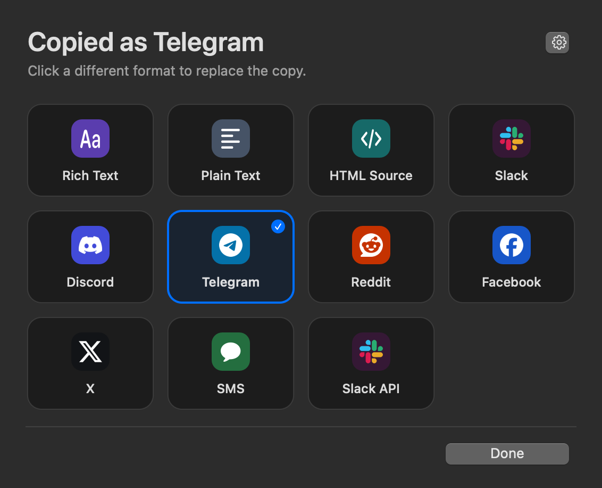

# macOS build and packaging

The menu-bar app supports macOS 13.5 or later on Apple silicon and Intel. It bundles the same converter as the CLI and a matching universal Node runtime.

With Xcode Command Line Tools and the repository dependencies installed, run `pnpm build:macos-app`. It writes `copied.md.app` and `copied-md-macos-universal.zip` under `build/portable`. Set `COPIED_MD_APP_OUT` to use a different output directory. Set `COPIED_MD_NODE_CACHE` to override the runtime archive cache at `build/macos-runtimes`.

Run `pnpm build:macos` for the standalone pasteboard helper. Set `COPIED_MD_MACOS_OUT` to override its default output at `build/macos`.

## Signing and checks

The default build uses a local ad-hoc signature. Set `COPIED_MD_SIGN_IDENTITY` to a Developer ID Application identity for a distributable build, then notarize the package before distributing it.

Run the bundled executable with `--self-test` to check converter output, isolated pasteboard writes, stale-write protection, and hotkey registration.

```sh
build/portable/copied.md.app/Contents/MacOS/copied-md --self-test
```

## Use the format grid



Copy Markdown in another app, then press `⌃⌥⌘M`. Choose how the shortcut works in the menu bar under **Shortcut Behavior**.

- **Copy Last Used and Show Picker** copies immediately and opens the grid. Click another card to replace the copy, press Return to dismiss it, or switch to your paste destination. This is the default.
- **Show Picker First** waits for you to click a card or press Return to copy the highlighted format.
- **Copy Last Used Only** copies immediately without opening the grid.

Use **Copy Markdown As…** from the menu bar whenever you want to choose before copying. The gear menu saves your column count and visible formats. The app remembers a format after a successful clipboard write and uses the original Markdown if you replace an automatic copy.
